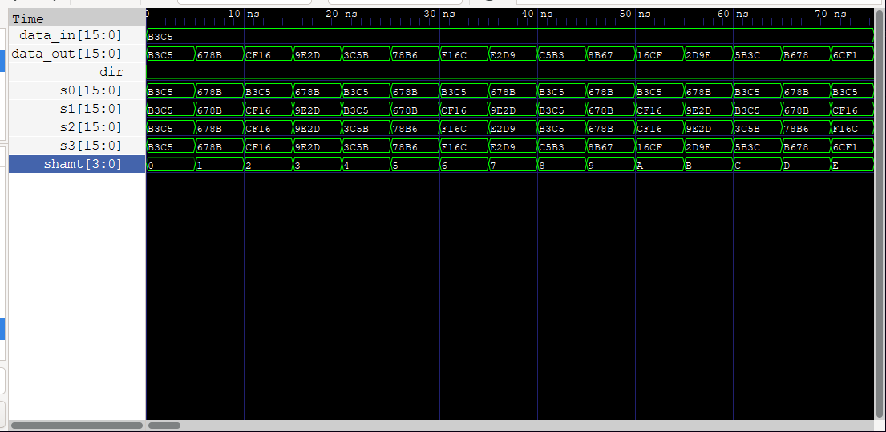

# Shift Unit

Verilog shift units for a 16-bit datapath.

| Module | File | Status |
|---|---|---|
| Logical shift unit | `logical_shift_unit.v` | Done, with testbench |
| Circular (rotate) shift unit | `circular_shift_unit.v` | Done, with testbench |
| Arithmetic shift unit | `arithmetic_shift_unit.v` | Done, with testbench |

All three units have the same ports and the same 4-stage barrel structure. The only difference is what fills the empty bit positions:

| Unit | Left shift fills with | Right shift fills with |
|---|---|---|
| Logical | `0` | `0` |
| Circular | bits from the MSB end | bits from the LSB end |
| Arithmetic | `0` | the sign bit `data_in[15]` |

## Logical shift unit

`logical_shift_unit` shifts a 16-bit value left or right by 0–15 positions. Bits that move out are dropped, and the empty positions are filled with `0`.

### Ports

| Port | Direction | Width | Description |
|---|---|---|---|
| `data_in` | input | 16 | Value to shift |
| `shamt` | input | 4 | Shift amount (0–15) |
| `dir` | input | 1 | `0` = shift left, `1` = shift right |
| `data_out` | output | 16 | Shifted result |

### Design

The unit is a combinational barrel shifter with four stages. Each stage is controlled by one bit of `shamt` and either passes its input through or shifts it by a fixed amount:

| Stage | Signal | Controlled by | Shift |
|---|---|---|---|
| 0 | `s0` | `shamt[0]` | 1 |
| 1 | `s1` | `shamt[1]` | 2 |
| 2 | `s2` | `shamt[2]` | 4 |
| 3 | `s3` | `shamt[3]` | 8 |

Any shift amount from 0 to 15 is a combination of these stages, so every shift takes the same four multiplexer levels. `data_out` is `s3`.

### Example

With `data_in = 16'hB3C5` (`1011001111000101`):

| `dir` | `shamt` | `data_out` |
|---|---|---|
| 0 (left) | 1 | `0110011110001010` (`16'h678A`) |
| 1 (right) | 12 | `0000000000001011` (`16'h000B`) |

## Circular shift unit

`circular_shift_unit` rotates a 16-bit value left or right by 0–15 positions. No bits are lost: bits that move out of one end come back in at the other end.

### Ports

| Port | Direction | Width | Description |
|---|---|---|---|
| `data_in` | input | 16 | Value to rotate |
| `shamt` | input | 4 | Rotate amount (0–15) |
| `dir` | input | 1 | `0` = rotate left, `1` = rotate right |
| `data_out` | output | 16 | Rotated result |

### Design

It uses the same four stages as the logical unit (`s0`–`s3`, rotating by 1, 2, 4 and 8 under control of `shamt[0]`–`shamt[3]`). Each stage wraps the bits it moves out around to the other end instead of filling with zeros. Rotating by 8 left and by 8 right give the same result, so stage 3 is identical in both directions.

### Example

With `data_in = 16'hB3C5` (`1011001111000101`):

| `dir` | `shamt` | `data_out` |
|---|---|---|
| 0 (left) | 1 | `0110011110001011` (`16'h678B`) |
| 1 (right) | 4 | `0101101100111100` (`16'h5B3C`) |

## Arithmetic shift unit

`arithmetic_shift_unit` shifts a 16-bit two's-complement value left or right by 0–15 positions. A right shift copies the sign bit into the empty positions, so the value keeps its sign and the result equals division by 2ⁿ rounded toward negative infinity. A left shift fills with zeros and is the same as a logical left shift (multiplication by 2ⁿ, without overflow detection).

### Ports

| Port | Direction | Width | Description |
|---|---|---|---|
| `data_in` | input | 16 | Signed value to shift |
| `shamt` | input | 4 | Shift amount (0–15) |
| `dir` | input | 1 | `0` = shift left, `1` = shift right |
| `data_out` | output | 16 | Shifted result |

### Design

It uses the same four stages (`s0`–`s3`, shifting by 1, 2, 4 and 8 under control of `shamt[0]`–`shamt[3]`). In right shifts, each stage fills the top bits with copies of `data_in[15]`, the original sign bit.

### Example

Right shifts by 4 of a negative and a positive value:

| `data_in` | `dir` | `shamt` | `data_out` |
|---|---|---|---|
| `1011001111000101` (`16'hB3C5`, negative) | 1 (right) | 4 | `1111101100111100` (`16'hFB3C`) |
| `0011001111000101` (`16'h33C5`, positive) | 1 (right) | 4 | `0000001100111100` (`16'h033C`) |

## Simulation

Requires [Icarus Verilog](https://steveicarus.github.io/iverilog/) and, for waveforms, [GTKWave](https://gtkwave.sourceforge.net/).

Each unit has two testbenches:

| Testbench | Purpose |
|---|---|
| `<unit>_shift_unit_directed_tb.v` | Sweeps every shift amount (0–15) in both directions on a fixed input and prints each result. Use it to read the behavior and to view a clean waveform in GTKWave. |
| `<unit>_shift_unit_random_tb.v` | Applies `NUM_TESTS` (default 1000) random inputs and checks each `data_out` against a behavioral model, printing any mismatch and then `ALL 1000 TESTS PASSED` or the failure count. |

The directed testbenches use the input `16'hB3C5`. The arithmetic one also uses the positive value `16'h33C5`, so you can see the sign bit fill with both `1` and `0`.

The random testbenches use these reference models:

| Unit | Left | Right |
|---|---|---|
| Logical | `x << n` | `x >> n` |
| Circular | `(x << n) \| (x >> (16 - n))` | `(x >> n) \| (x << (16 - n))` |
| Arithmetic | `x << n` | `$signed(x) >>> n` |

Every testbench writes a `.vcd` file named after itself, which includes the internal stage signals `s0`–`s3`.

To run a testbench, replace `<unit>` with `logical`, `circular` or `arithmetic`.

Directed test:

```sh
iverilog -o <unit>_directed.vvp <unit>_shift_unit.v <unit>_shift_unit_directed_tb.v
vvp <unit>_directed.vvp
gtkwave <unit>_shift_unit_directed_tb.vcd
```

Random self-checking test:

```sh
iverilog -o <unit>_random.vvp <unit>_shift_unit.v <unit>_shift_unit_random_tb.v
vvp <unit>_random.vvp
```

The `.vvp` and `.vcd` files are build outputs and are ignored by git.

### Waveforms

Logical shift unit:


Circular shift unit:



Arithmetic shift unit:


