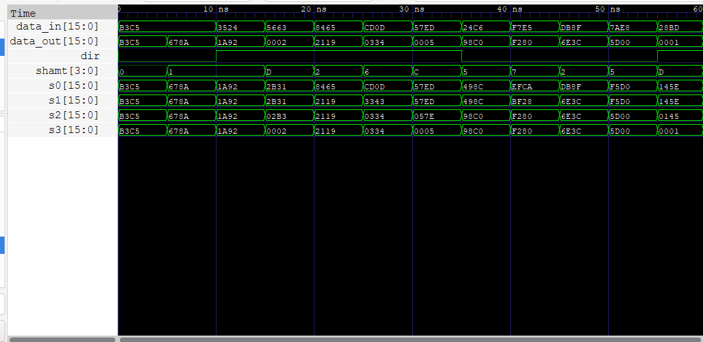

# Shift Unit

Verilog shift units for a 16-bit datapath.

| Module | File | Status |
|---|---|---|
| Logical shift unit | `logical_shift_unit.v` | Done, with testbench |
| Circular (rotate) shift unit | `circular_shift_unit.v` | Planned |

## Logical shift unit

`logical_shift_unit` shifts a 16-bit value left or right by 0–15 positions. Bits that move out are dropped, and the empty positions are filled with `0`.

### Ports

| Port | Direction | Width | Description |
|---|---|---|---|
| `data_in` | input | 16 | Value to shift |
| `shamt` | input | 4 | Shift amount (0–15) |
| `dir` | input | 1 | `0` = shift left, `1` = shift right |
| `data_out` | output | 16 | Shifted result |

### Design

The unit is a combinational barrel shifter with four stages. Each stage is controlled by one bit of `shamt` and either passes its input through or shifts it by a fixed amount:

| Stage | Signal | Controlled by | Shift |
|---|---|---|---|
| 0 | `s0` | `shamt[0]` | 1 |
| 1 | `s1` | `shamt[1]` | 2 |
| 2 | `s2` | `shamt[2]` | 4 |
| 3 | `s3` | `shamt[3]` | 8 |

Any shift amount from 0 to 15 is a combination of these stages, so every shift takes the same four multiplexer levels. `data_out` is `s3`.

### Example

With `data_in = 16'hB3C5` (`1011001111000101`):

| `dir` | `shamt` | `data_out` |
|---|---|---|
| 0 (left) | 1 | `0110011110001010` (`16'h678A`) |
| 1 (right) | 12 | `0000000000001011` (`16'h000B`) |

## Simulation

Requires [Icarus Verilog](https://steveicarus.github.io/iverilog/) and, for waveforms, [GTKWave](https://gtkwave.sourceforge.net/).

```sh
iverilog -o logical.vvp logical_shift_unit.v logical_shift_unit_tb.v
vvp logical.vvp
gtkwave logical_shift_unit_tb.vcd
```

The testbench `logical_shift_unit_tb.v`:

1. Applies a few fixed shifts to `16'hB3C5` and prints the results.
2. Applies random inputs and compares `data_out` with Verilog's `<<` and `>>` operators, reporting any mismatch.
3. Prints `ALL TESTS PASSED` or the number of failures.
4. Writes `logical_shift_unit_tb.vcd`, which includes the internal stage signals `s0`–`s3`.

The `.vvp` and `.vcd` files are build outputs and are ignored by git.

### Waveform


